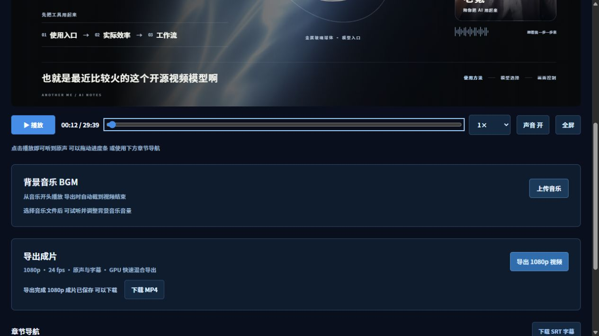
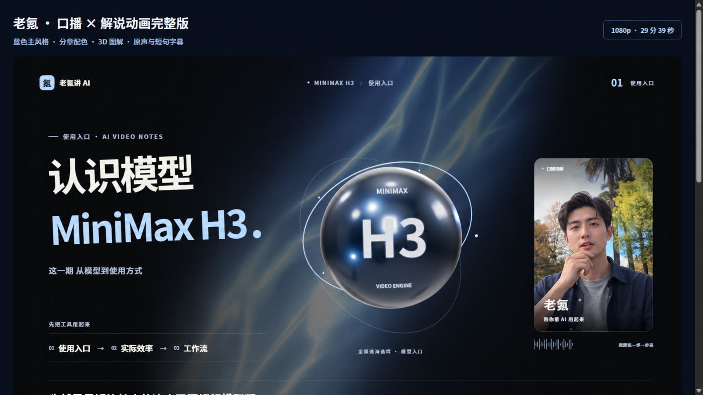

# Talking Head Studio / Layered Video Export

**给 Agent 一个口播视频，让它完成字幕、内容图解、3D 包装、网页预览和分层加速导出。自带 Studio Blue 风格模板，也支持下载新模板接入。**

这是一套供现有 Agent 执行的本地后期工作流。Agent 理解口播、决定画面和校对时码；程序负责转写、构建和渲染。不需要再为本项目配置 AI API Key。需要支持读写文件、执行命令和检查页面的 Agent；仅下载仓库不会自动启动一个隐藏的 AI 服务。

## 页面与模板预览

网页集中提供播放、进度控制、BGM、章节、字幕与视频导出功能：



自带 Studio Blue 模板支持连续背景、信息排版、人物侧栏和 3D 内容图解：



预览图中的人物为虚构演示形象，不包含用户肖像或测试视频。

## 模块化协作

工作流由素材接入、语音转写、内容编排、视觉设计、动效代码、3D、字幕音频、分层渲染和独立复核九个模块组成。模块之间通过明确的文件协议交接；任何模块都可以单独返工，已确认的时码、模板风格和导出协议不会被隐式改写。详细职责、输入输出与回退规则见 [MODULES.md](MODULES.md)，机器可读清单见 [workflow.modules.json](workflow.modules.json)。

现有 Studio Blue 模板与分层导出引擎仍是最终执行基准。模块化用于减少职责混杂和漏检，不改变已经确认的版式、动画节奏、3D 质感、字幕规则与 1080p24 成片结果。

## 用户怎么用

```sh
git clone https://github.com/YT-kexuejia/layered-video-export.git
```

把目录和视频交给 Agent，直接说：

> 阅读 SKILL.md，用自带模板给这个口播视频配解说画面和后期，先给我网页预览与 SRT，我确认后再导出。

Agent 按 [SKILL.md](SKILL.md) 完成环境检查、本地转写、语义编排、模板构建、网页检查与交付。详细命令在 [WORKFLOW.md](WORKFLOW.md)。素材不离开本机；Agent 如果使用云端模型分析转写文本，其数据处理由用户所选 Agent 决定。

## 自带模板

Studio Blue 提供科技风排版、蓝色程序光带、侧栏人物、章节配色、金属球体、GPU/服务器/装配层/镜头轨道/天平等3D，以及对比、节点图、图表、分镜、编辑时间线和文字图解。模板保留内容层级、渐显与合理转场，按口播实际时码揭示信息。字幕用空格分句，长句按词时码切分。

动效使用 **MIT Anime.js**，3D 使用 **MIT Three.js**，光带独立实现。字体可选择本机思源黑体；字体文件和用户肖像不预装。素材需使用获授权的来源。

后续模板可以独立放在 GitHub 或下载包，提供 template.json 后通过 `pipeline.py build --template DIRECTORY` 接入，详见 [TEMPLATES.md](TEMPLATES.md)。当前模板接口保持固定的1080p24分层协议，改变人物合成几何需要同步适配，不能直接导入任意网页。

## 预览与导出

网页提供播放、拖动、倍速、章节跳转、SRT下载、开始/继续/暂停导出和成片下载。原声最终与合成画面一起导出。默认1080p、24fps，无背景音乐。

| 图层 | 加速方式 |
| --- | --- |
| 背景与3D | 确定性时间驱动，通过 WebCodecs 编码连续图层 |
| 图文 UI | 变化区间截图，静止区间复用 |
| 波形 | ManimGX 生成小型透明图层 |
| 人物视频 | FFmpeg 连续解码、裁切合成，不让浏览器逐帧定位 |
| 成片 | NVIDIA NVENC 编码段落，最后拼接并加入原声 |

**每五分钟合成并验证一个段落，再删除该段图片和临时图层。** 中断保留未完成素材，继续复用已有图片及完成图层；未完成的GPU流可能需要重做当前段。视频、已完成段落和 manifest 保留。修改模板/计划后用新任务，避免混合不同版本缓存。

速度取决于硬件、动态图文密度、源视频和磁盘，不承诺固定倍数。网页展示整体实测帧/秒，不以某个GPU阶段速度冒充完整导出速度。

## 环境与边界

已支持目标：Windows、NVIDIA NVENC、Chrome AVC WebCodecs、Python3.13+、Node22+、FFmpeg与ffprobe。首次安装 npm/Python依赖和语音模型需要联网。CPU转写可用；高质量GPU转写需CUDA/cuDNN。当前导出引擎没有完成跨平台及非NVIDIA回退验证。

这是自动化生产工具，不保证无人校对便可发布：产品名转写、口播与画面对齐、人物裁切、素材授权仍由 Agent 检查。README不把模板示意图当作产品真实截图，也不把预设文案当作事实。

## 许可

本项目自有代码与自带模板采用 MIT；依赖分别遵守上游许可。ManimGX原生wheel含GPL组件，FFmpeg许可依构建而异，本仓库不打包这些二进制。详情见 [THIRD-PARTY-NOTICES.md](THIRD-PARTY-NOTICES.md) 与 [LICENSE-AUDIT.md](LICENSE-AUDIT.md)。请勿提交用户视频、转写、输出、缓存、私密配置或密钥。
